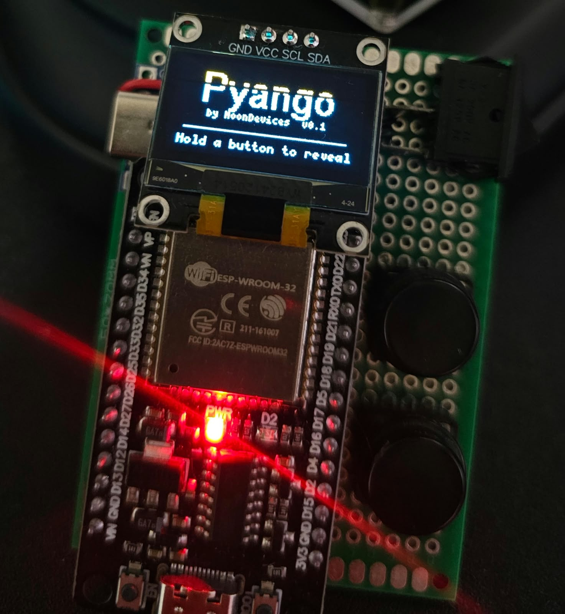
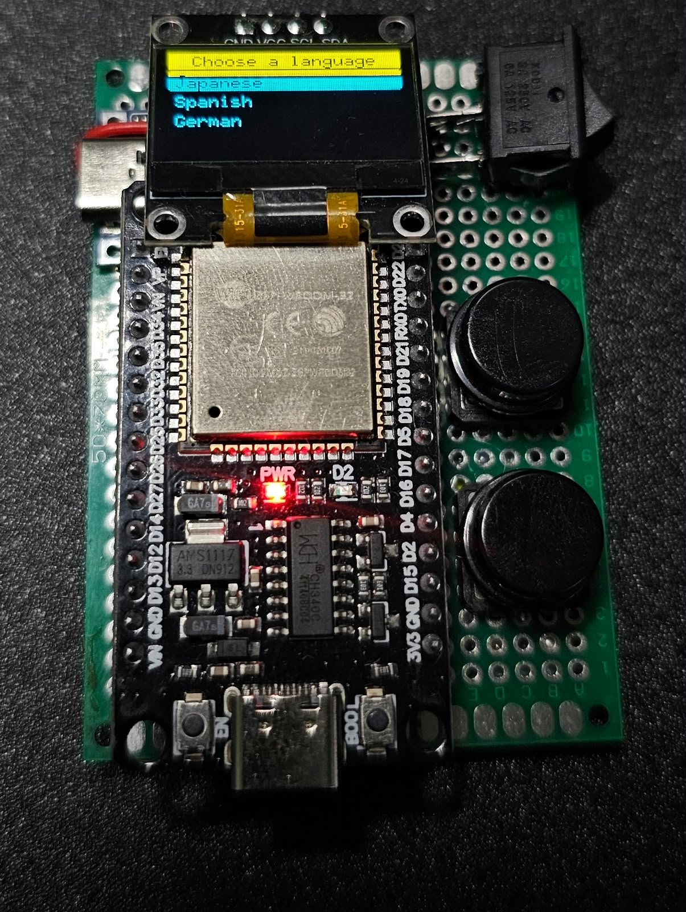
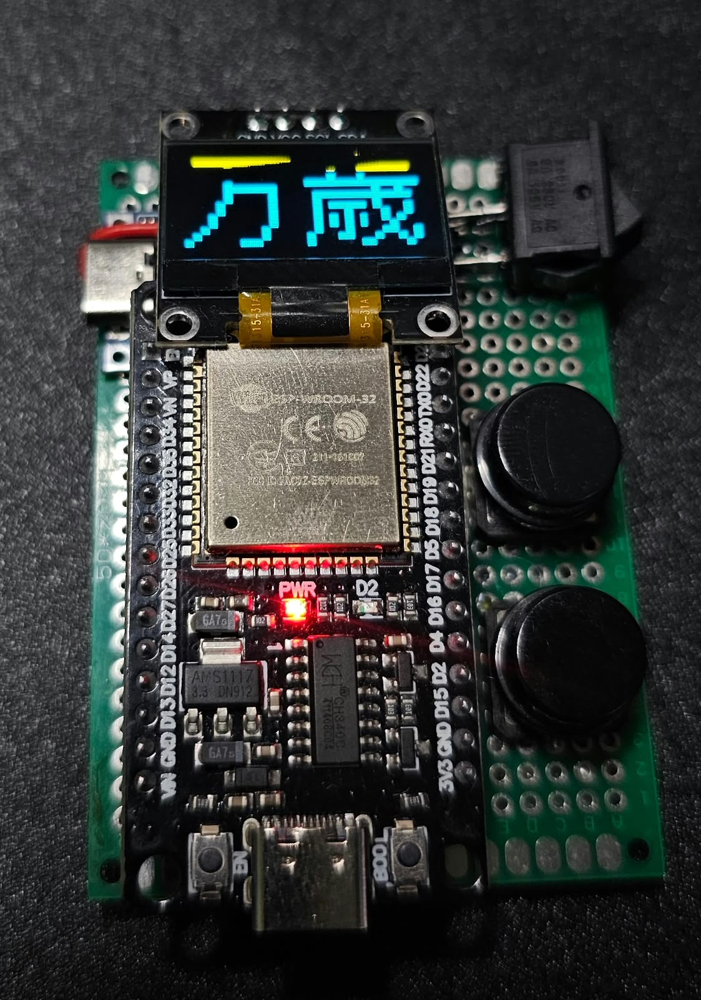
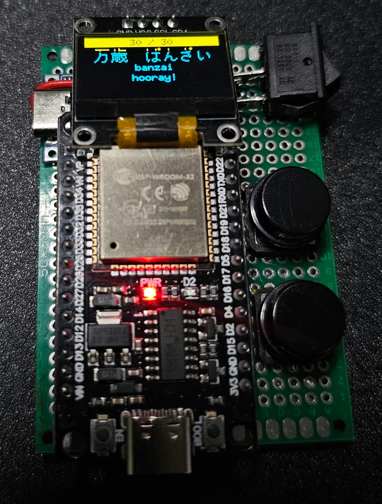
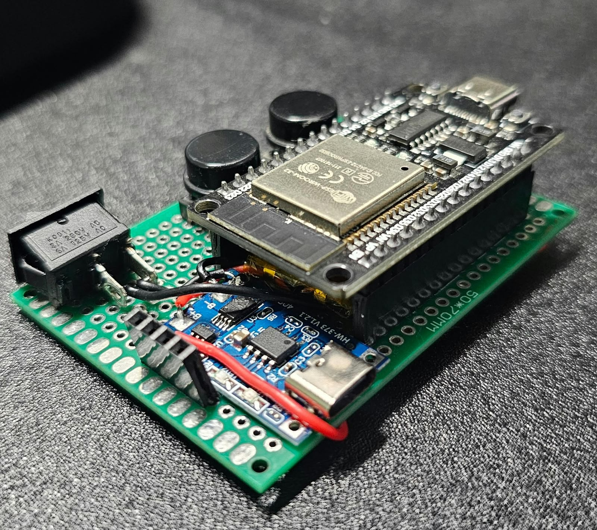
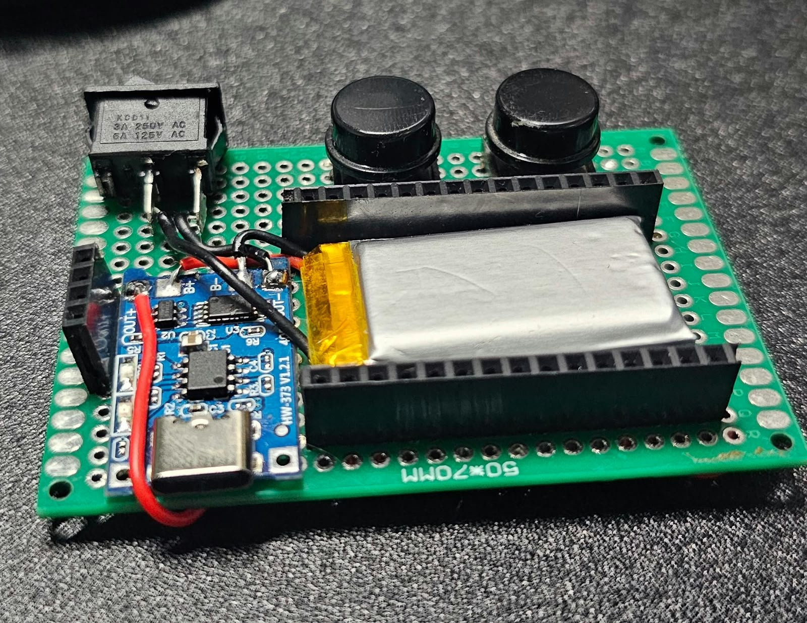

# Pyango

**Pocket flashcards for learning languages.**




---

## The story

Pyango started in Spanish, my native language, as a simple way to keep my flashcards and practice for a Japanese exam I had coming up. It was just a small screen, two buttons and the basic words I needed to review in Japanese and German.

But while I was studying, a question kept coming back to me: how could I make learning languages more functional and more interactive? How could I combine my two favorite things, learning languages and building electronics projects?

That's how Pyango was born: an interactive companion that helps you learn languages and keeps you company throughout your day.

For this first public release I translated everything into English so it can reach more people. It's simple on purpose: two buttons and flashcards to learn Spanish, German and Japanese. Next comes a pet that helps you keep up with your language studies.

---

## What it does (v0.1)

- **Pick a language, then a category:** Numbers, Verbs, Positions/Directions, Everyday words, or **(All together)** to mix them all.
- **See the word, try to remember it, then hold a button to reveal the answer.**
- **Full-screen kanji** for Japanese, with kana and romaji on the answer screen.
- **Pronunciation guides** for Spanish and German, plus plurals.
- **Easy to extend:** decks are plain TSV files you can edit like a spreadsheet.

<p align="center">
  
  
</p>

### Included decks

| Language | Cards | Categories |
|---|---|---|
| Japanese | 86 | numbers, verbs, positions & directions, everyday words |
| Spanish | 69 | numbers, verbs, positions & directions, everyday words |
| German | 75 | numbers, verbs, positions & directions, everyday words |

Want your language? Adding a deck is as easy as editing a spreadsheet. See [decks/README.md](decks/README.md).

## How to use it

Pyango has only two buttons. Everything works with **short presses** and **holds**:

| Action | In the menus | On a card |
|---|---|---|
| **Short press** left / right | Move up / down | Previous / next card |
| **Hold one button for 1 second** | Select | **Reveal the answer** (hold again to hide it) |
| **Press both buttons** | Go back | Back to the categories |

> **Important: to reveal a word, keep the button pressed.** A small bar fills up at the bottom of the screen while you hold. When it's full (1 second), the answer appears. If you let go early, nothing happens, so you never reveal a card by accident.



**On a card, the answer screen shows:**
- **Japanese:** the kanji with its kana, the romaji and the meaning.
- **Spanish / German:** the word, a pronunciation guide, the plural (for nouns) and the meaning.

## Hardware

| Part | Approx. cost |
|---|---|
| ESP32 DevKit V1 | $5 USD |
| SSD1306 0.96" 128x64 I2C OLED | $3 USD |
| 2 tactile push buttons | $1 USD |
| Perfboard and wires | $2 USD |
| 400 mAh LiPo + TP4056 charger + power switch | $5 USD |

| Component | Pin | ESP32 DevKit V1 |
|---|---|---|
| OLED | VCC / GND | 3V3 / GND |
| OLED | SDA / SCL | GPIO21 / GPIO22 |
| Left button | — | GPIO32 and GND |
| Right button | — | GPIO33 and GND |

<p align="center">
  
  
</p>

No resistors needed: the firmware enables the ESP32's internal pull-ups.

> ⚠️ **Using the battery?** Read the [battery wiring and safety notes](docs/wiring.md#battery) first: turn the switch off before plugging USB into the ESP32, and set the TP4056 charge current for your battery.

## Getting started

1. Install [Arduino IDE 2](https://www.arduino.cc/en/software).
2. Add ESP32 support: *File → Preferences → Additional boards manager URLs*:
   `https://espressif.github.io/arduino-esp32/package_esp32_index.json`
   then install **esp32 by Espressif** from the Boards Manager.
3. Install the **U8g2** library from the Library Manager.
4. Open `firmware/pyango/pyango.ino`, select **ESP32 Dev Module** and upload.

## Roadmap

- [x] **v0.1** — Flashcards: 2 buttons, categories, Japanese, Spanish and German
- [ ] **v0.2** — The pet: a companion with moods that you feed by studying, quizzes and spaced repetition
- [ ] **v0.3** — Clock, alarms and study reminders over WiFi
- [ ] **v0.4** — Mini games and choosing your pet (cat, dog, bunny...)
- [ ] **v0.5** — Round color display (ESP32-S3 + LVGL)
- [ ] **v1.0** — Custom PCB, 3D-printable case and built-in battery

## Contributing

Pull requests are welcome, especially **new decks**. Found a wrong translation? Open an issue. Built your own Pyango? Share it in Discussions!

## License

- Firmware and tools: [MIT](LICENSE)
- Decks: CC BY-SA 4.0
- Hardware: CERN-OHL-S

**Pyango** and **MoonDevices** are the project's names. You're free to build, modify and share your own Pyango; we only ask that you don't sell products under these names without permission.

---

## Edición en español

Pyango también tiene una edición con menús y explicaciones en español, para aprender **inglés, alemán y japonés**. Para usarla, abre `firmware/pyango/pyango.ino` y cambia esta línea:

```cpp
#define PYANGO_ENGLISH 1
```

por:

```cpp
#define PYANGO_ENGLISH 0
```

Los mazos de esta edición están en [decks/es/](decks/es/).
